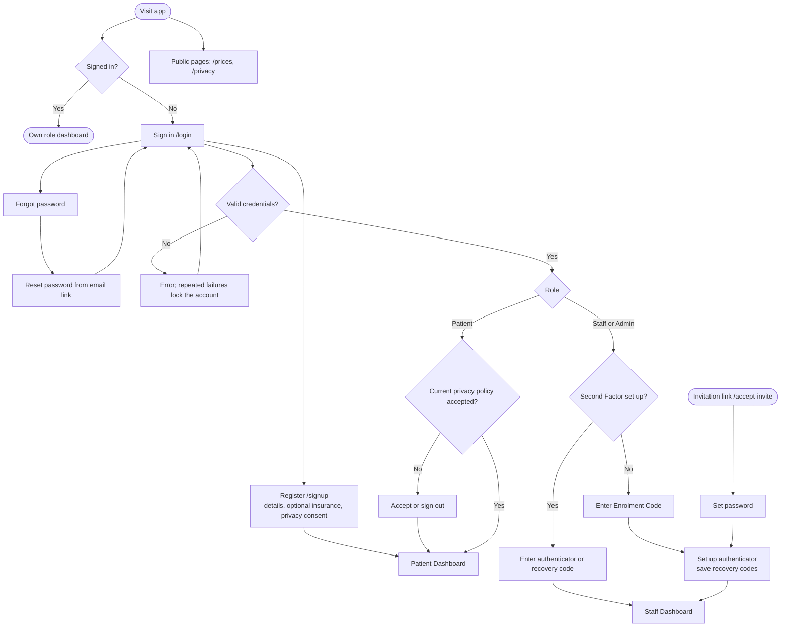
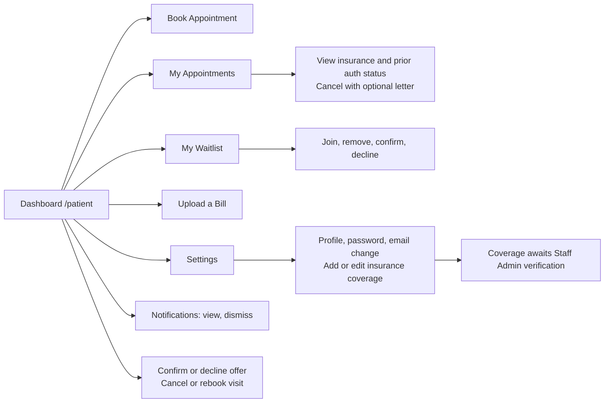
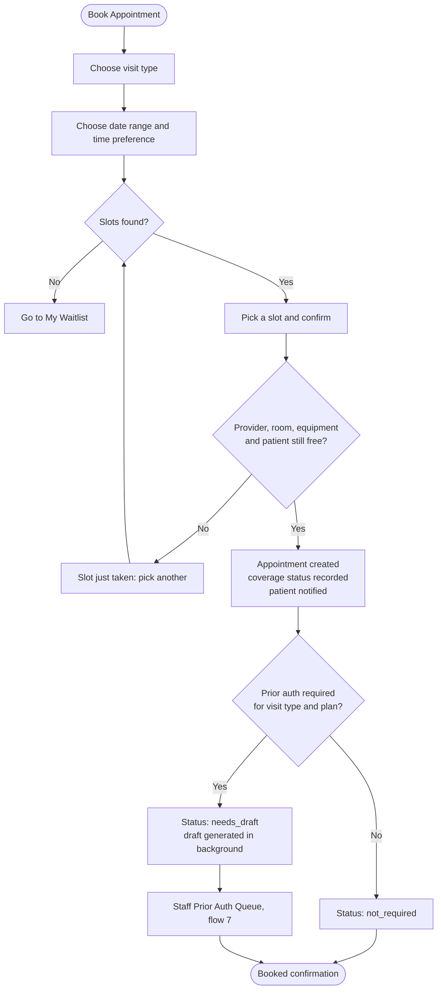
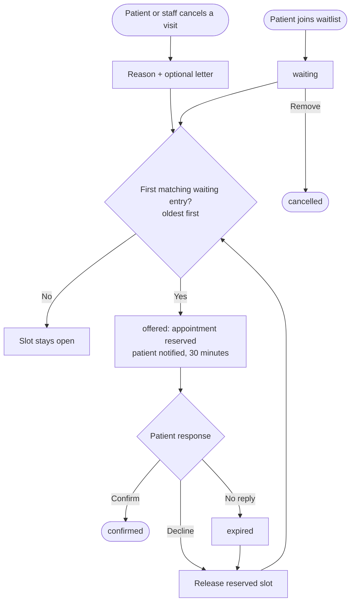
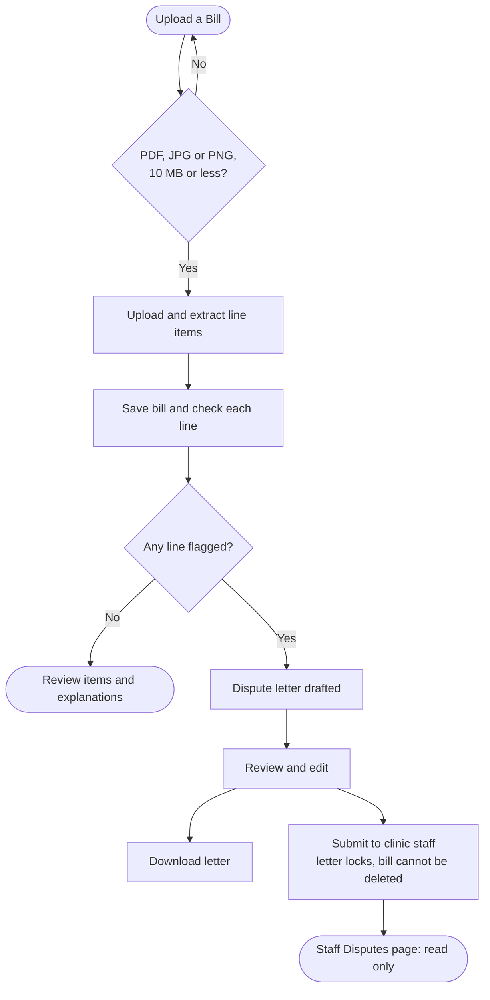
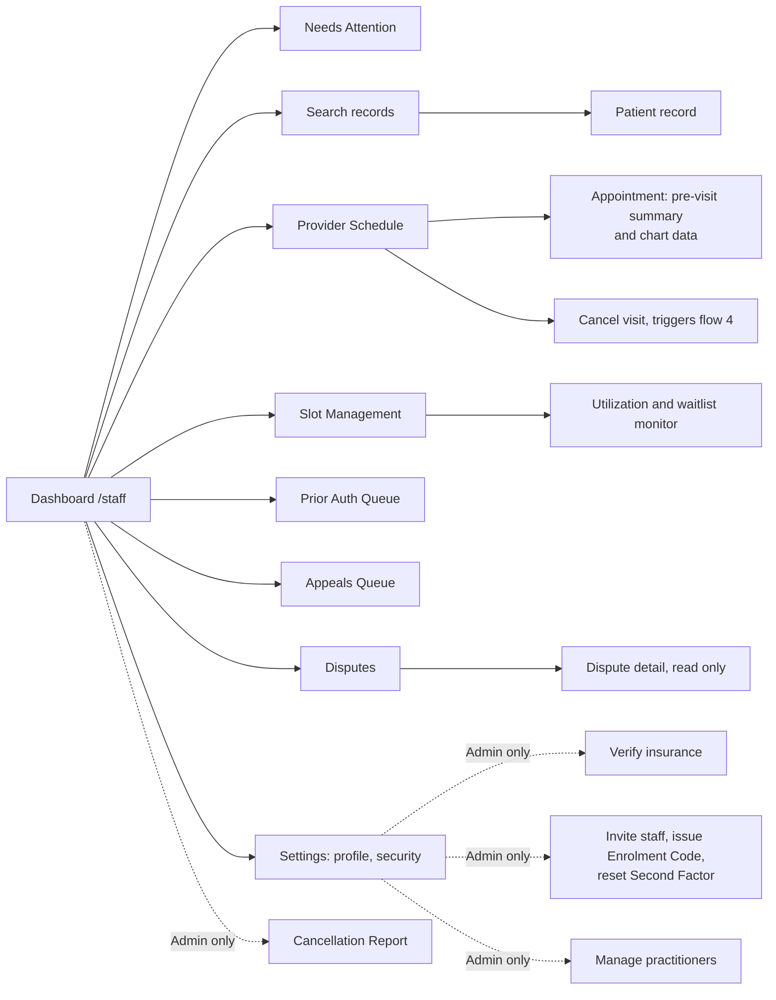
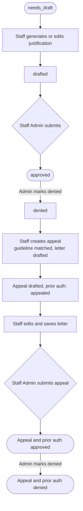

# JuanAccess User Flows and Interaction Flowcharts

Drawn from the code (client routes, pages, server controllers), not from `docs.md`.

Roles: **Patient**, **Staff** (`staff`), **Staff Admin** (`staff_admin`). Rounded = start/end, rectangle = screen or action, diamond = decision.

## 1. Entry, sign-in and account access

## 2. Patient portal map

## 3. Booking a visit

## 4. Cancellation and waitlist

## 5. Bill review and dispute

## 6. Staff portal map

## 7. Prior authorization and appeal

Insurer decisions are simulated. Submitting from the UI returns **approved**; a denial is recorded by a Staff Admin with "Mark denied".

## Permissions

| Action                                                      | Patient | Staff | Staff Admin |
| ----------------------------------------------------------- | :-----: | :---: | :---------: |
| Book, join waitlist, upload and dispute bills               |   Yes   |  No   |     No      |
| Cancel appointments                                         |   Own   |  Yes  |     Yes     |
| View schedules, records, queues, disputes                   |   No    |  Yes  |     Yes     |
| Draft prior auths and appeals                               |   No    |  Yes  |     Yes     |
| Submit and decide prior auths and appeals                   |   No    |  No   |     Yes     |
| Verify insurance, manage staff and practitioners, reporting |   No    |  No   |     Yes     |
